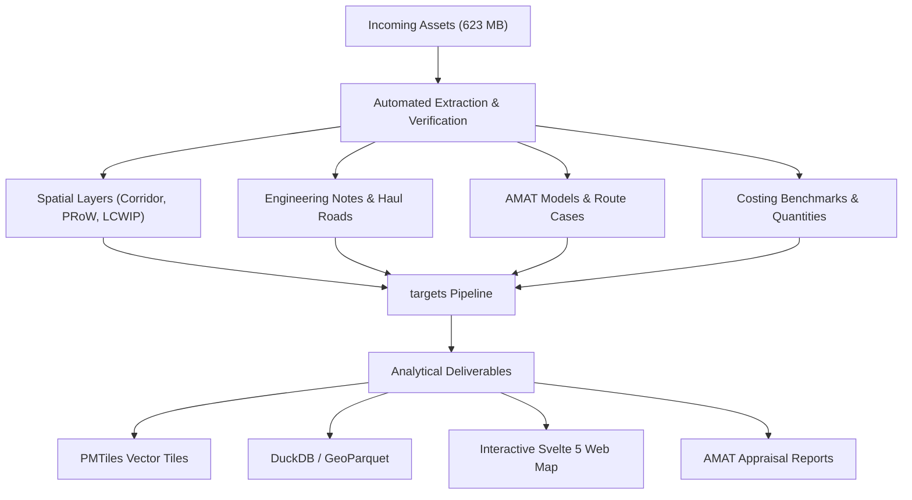

## Overview

 

This document catalogs incoming data assets received in the October 2026 project archive (`OneDrive_2026-10-05.zip`).

 

The archive comprises **42 primary assets** (~623 MB uncompressed) plus **3 nested spatial archives** containing over 280 shapefiles and KMZ layers. These assets span strategic policy and benefits reviews, engineering feasibility studies by John Grimshaw CBE, site access road (SAR) retention proposals, public rights of way (PRoW), canals, local cycling plans (LCWIPs), and economic appraisal models using the DfT Active Modes Appraisal Toolkit (AMAT).

 

---

## Interactive Asset Register

 

Use the search bar, sort columns, or paginate through the complete inventory of incoming files below:

 

```{r}
library(readr)
library(dplyr)
library(DT)

inv <- read_csv("data/data_inventory.csv", show_col_types = FALSE)

display_df <- inv |>
  select(
    `ID` = id,
    `Category` = category,
    `Work Package` = work_package,
    `File Name` = FileName,
    `Size (MB)` = SizeMB,
    `Geography` = geographic_scope,
    `Pipeline Action` = pipeline_action
  )

datatable(
  display_df,
  options = list(
    pageLength = 15,
    autoWidth = TRUE,
    searchHighlight = TRUE,
    dom = "Bfrtip"
  ),
  filter = "top",
  rownames = FALSE
)
```

 

---

## Summary by Category and Work Package

 

```{r}
summary_stats <- inv |>
  group_by(Category = category, `Work Package` = work_package) |>
  summarise(
    `File Count` = n(),
    `Total Size (MB)` = round(sum(SizeMB), 2),
    .groups = "drop"
  ) |>
  arrange(desc(`Total Size (MB)`))

knitr::kable(summary_stats, caption = "Summary of Incoming Datasets by Thematic Cluster")
```

 

---

## Thematic Cluster Profiles

 

### Cluster 1: Spatial Network & Core GIS Layers (WP2)

 

- **Corridor Alignments**: Official shapefiles and KML representations of the North-South active travel corridor across Phase 1, Phase 2a, and regional feeder branches.

- **Public Rights of Way & Local Networks**: Over 280 spatial layers spanning definitive PRoW maps (Buckinghamshire, Northamptonshire, Staffordshire, Warwickshire), Canal & River Trust (CRT) waterways, Crewe and Warwickshire LCWIP priority networks, and the TfWM Starley Network.

 

### Cluster 2: John Grimshaw Engineering & Feasibility Studies (WP1 / WP2)

 

- **All-Sections Design Notes (`HS2-DFT-HW-REP-000-000002`, 309.4 MB)**: Detailed engineering notes documenting civil works interfaces along Phase 1 and Phase 2a, identifying overbridges, underpasses, trace crossings, and potential greenway alignments.

- **HS2 Cycleway Feasibility Report (`HS2-DFT-HW-REP-000-000002`, 14.7 MB)**: Baseline feasibility study establishing how a continuous national cycling and walking corridor can be achieved alongside railway civil engineering works.

- **County-Level Interface Studies**: Granular interface assessments for Buckinghamshire, Northamptonshire, Warwickshire, Solihull, Birmingham, and Staffordshire.

 

### Cluster 3: Section Infrastructure & Haul Road Retentions (WP2)

 

- **Wormleighton to Southam (Northamptonshire to Warwickshire)**: Specific engineering proposals to retain Site Access Roads (SAR), Construction Access Roads (CAR), and Maintenance Access Tracks (MAT) as permanent active travel infrastructure rather than removing them post-construction.

- **Buckinghamshire**: Quainton to Calvert greenway alignment integrating with East West Rail (EWR) corridor connections.

- **West Midlands / Solihull**: Engineering drawings and regional network integration connecting Birmingham Curzon Street, Birmingham Interchange, and Coventry.

 

### Cluster 4: Economic Appraisal (AMAT) & Demand Evidence (WP3)

 

- **Rural Schemes Economic Case Benchmark**: Peer-reviewed strategic business cases establishing baseline benefit-cost ratios (BCRs) and monetised health/decongestion benefits for rural active travel schemes.

- **Route Case (RC) Summaries**: Granular scheme appraisal notes for key corridor sections: Balsall Common, Ladbroke, Old Oak Common, Wormleighton, and Amersham to Chalfont St Giles.

- **Empirical Baseline Count Data**: Automatic counter counts from comparable greenway schemes to calibrate AMAT induced trip forecasts.

 

### Cluster 5: Cost Benchmarks & Maintenance (WP3)

 

- **All-Sections Combined Cost Estimate (`23105_HS2 Cost Estimate RevC.xlsx`, 1.3 MB)**: Detailed itemized bill of quantities across all route sections, providing civil engineering, surfacing, drainage, structure, and fencing unit costs.

- **DfT Typical Costings Guide**: DfT standard per-kilometer cost benchmarks for ambitious cycling schemes.

- **Sustrans Maintenance & Whole-Life Unit Costs**: Annual operating and maintenance expenditure benchmarks (£/km/year) and 20-/30-year whole-life replacement cost models across surfacing options.

 

---

## Data Management & Pipeline Ingestion Plan

 



 

---

## Priority Meeting Discussion Topics

 

For upcoming stakeholder and team meetings, the following priority agenda items are highlighted:

 

- **1. Haul Road / SAR Retention Window**: Engage HS2 Ltd and main works civils contractors (MWCC) regarding contractor handover timetables for Site Access Roads in Warwickshire and Buckinghamshire before compound demobilization.

- **2. Alignment Harmonization**: Agree on whether the Shapefile (`North-South Cycleway Alignment.zip`) or the KML (`Copy of North - South Cycleway 2025.kml`) is adopted as the definitive v2026 centerline for the pipeline and web map.

- **3. AMAT Appraisal Scenarios**: Confirm whether economic appraisal will be reported as a unified whole-route corridor scheme (London to Birmingham) or modular route cases (e.g. Balsall Common, Ladbroke, Quainton-Calvert, Old Oak Common).

- **4. Data Sharing & Licensing Protocol**: Establish which layers can be published openly on the public web map (e.g. PRoW, NCN, LCWIPs, corridor centerline) vs proprietary HS2 contractor drawings that remain internal to the project team.
